<p align="center">
  
</p>

<p align="center">
  A full-stack learning and assessment platform for structured computer science education — built with <strong>React</strong>, <strong>Laravel</strong>, and <strong>MySQL</strong>.
</p>

<p align="center">
  
  
  
  
  
</p>

<p align="center">
  <a href="./"></a>
  <a href="https://github.com/thedevamina"></a>
</p>

<br/>

## What I Built

<table>
  <tr>
    <td width="25%" valign="top">
      <h3>📚 Structured Learning</h3>
      <p>Three chapter-based computer science courses with rich, API-served lesson content.</p>
    </td>
    <td width="25%" valign="top">
      <h3>📝 Assessments</h3>
      <p>Chapter tests, midterms, and final exams with server-side scoring and persisted results.</p>
    </td>
    <td width="25%" valign="top">
      <h3>📊 Progress</h3>
      <p>Per-course chapter completion and progress, alongside student test and exam results.</p>
    </td>
    <td width="25%" valign="top">
      <h3>🔐 Access & Content</h3>
      <p>Sanctum-authenticated student accounts and role-checked admin content management.</p>
    </td>
  </tr>
</table>

<br/>

## Modules

<table>
  <tr>
    <td width="50%" valign="top">
      <h3>📚 Courses & Chapters</h3>
      <p>Course records with ordered chapters, descriptions, status, duration, and completion tracking.</p>
      <p>
        
        
      </p>
    </td>
    <td width="50%" valign="top">
      <h3>📖 Learning Materials</h3>
      <p>Structured lesson sections, explanations, concepts, code examples, and notes stored as chapter material and returned by the API.</p>
      <p>
        
        
      </p>
    </td>
  </tr>
  <tr>
    <td width="50%" valign="top">
      <h3>📝 Chapter Assessments</h3>
      <p>Chapter tests use persisted questions and options, including correct-answer flags; submissions create attempts, answers, and results.</p>
      <p>
        
        
      </p>
    </td>
    <td width="50%" valign="top">
      <h3>🎓 Midterms & Finals</h3>
      <p>Course-level exams with stored questions, options, correct indexes, answer records, attempts, and results.</p>
      <p>
        
        
      </p>
    </td>
  </tr>
  <tr>
    <td width="50%" valign="top">
      <h3>📊 Progress & Dashboard</h3>
      <p>Authenticated dashboard data and course progress calculated from that student's persisted chapter completions.</p>
      <p>
        
        
      </p>
    </td>
    <td width="50%" valign="top">
      <h3>🛠️ Admin Content Management</h3>
      <p>Role-checked CRUD for courses, chapters, learning materials, questions/options, and exam questions with correct answers.</p>
      <p>
        
        
      </p>
    </td>
  </tr>
</table>

<br/>

## Architecture

<p align="center">
   →
   →
   →
  
</p>

<p align="center">
  
</p>

The React application calls Laravel's JSON API. API routes are handled by `ApiController`, which uses Laravel's database query builder for course, lesson, assessment, and progress data. Sanctum bearer tokens protect account, progress, submission, and admin operations; Eloquent models define the user and profile relationships.

```
src/
├── App.tsx
├── main.tsx
├── index.css
├── lib/
│   ├── auth.tsx
│   ├── useUserData.ts
│   ├── quizData.ts
│   └── lessonContent.ts       → retained content module; lessons load through the API
└── services/
    └── api.ts                 → Laravel API client

backend/
├── app/
│   ├── Http/Controllers/ApiController.php
│   └── Models/                 → User and Profile
├── routes/api.php
├── database/
│   ├── migrations/
│   └── seeders/                → course data and rich lesson content
└── tests/
    ├── Feature/                → admin, lesson API, and progress tests
    └── Unit/
```

<br/>

## Tech Stack

<p>
  <strong>Frontend</strong><br/>
  
  
  
  
  
  <br/>
  <strong>Backend</strong><br/>
  
  
  
  <br/>
  <strong>Database & Tools</strong><br/>
  
  
  
  
</p>

<br/>

## Database

Core records live in MySQL/MariaDB. Lesson material and exam options are stored as JSON, while chapter test options and answer records use related tables.

<table>
  <tr><th>Entity</th><th>Current records</th></tr>
  <tr><td>Courses</td><td>3</td></tr>
  <tr><td>Chapters</td><td>37</td></tr>
  <tr><td>Learning materials</td><td>37</td></tr>
  <tr><td>Chapter tests</td><td>37</td></tr>
  <tr><td>Questions / question options</td><td>64 / 256</td></tr>
  <tr><td>Exams / exam questions</td><td>6 / 48</td></tr>
</table>

The schema also includes users, profiles, test attempts and answers, test results, exam attempts and answers, and chapter completions.

<br/>

## API

The API is defined in `backend/routes/api.php`. Routes under `auth:sanctum` require a bearer token; admin routes additionally check the user's admin role.

- **Authentication:** `POST /api/auth/register`, `POST /api/auth/login`, `POST /api/auth/logout`, `GET /api/auth/me`
- **Courses & learning:** `GET /api/courses`, `GET /api/courses/{course}`, `GET /api/courses/{course}/chapters`, `GET /api/chapters/{chapter}/material`, `GET /api/courses/{course}/tests`, `GET /api/tests/{test}/questions`, `GET /api/courses/{course}/exams`, `GET /api/exams/{exam}/questions`, `GET /api/assessments/{course}/{type}/{chapter?}`
- **Assessments & results:** `POST /api/tests/submit`, `POST /api/exams/submit`, `POST /api/assessments/submit`, `POST /api/results`, `GET /api/results/{result}`
- **Progress & profile:** `GET|PUT /api/profile`, `GET /api/progress`, `GET /api/dashboard`, `POST /api/chapters/{chapter}/completion`
- **Admin:** `GET|POST|PUT|DELETE /api/admin/courses`, `/api/admin/chapters`, and `/api/admin/materials`; `GET|POST /api/admin/tests`; `GET|POST|PUT|DELETE /api/admin/questions` and `/api/admin/exam-questions`; `GET /api/admin/exams`.

<br/>

## Highlights

- 🔐 Bearer-token authentication and role-checked administration with Laravel Sanctum
- 📚 Rich chapter lessons served from MySQL through the learning-material API
- 📝 Assessment answers are scored by Laravel and recorded with attempts and results
- 📊 Course progress uses each student's course-specific chapter completions
- 🛠️ Admin content changes persist in the relational database
- 🧪 Laravel feature coverage for admin content CRUD, rich lesson API data, and course progress
- 🗄️ The configured XAMPP MySQL/MariaDB database has been verified against the application

<br/>

## Verification

<p>
  
  
  
  
</p>

The frontend typecheck and production build passed. Laravel tests, including the admin CRUD, rich lesson migration/API, and course progress feature tests, passed. The configured `code_quest` database contains all 37 chapter lesson records, and admin CRUD was verified against that database.

<br/>

---

<p align="center">
  <em>Built to make rigorous computer science learning feel structured, measurable, and within reach — one chapter at a time.</em>
</p>

<p align="center">
  <a href="https://github.com/thedevamina"></a>
</p>
